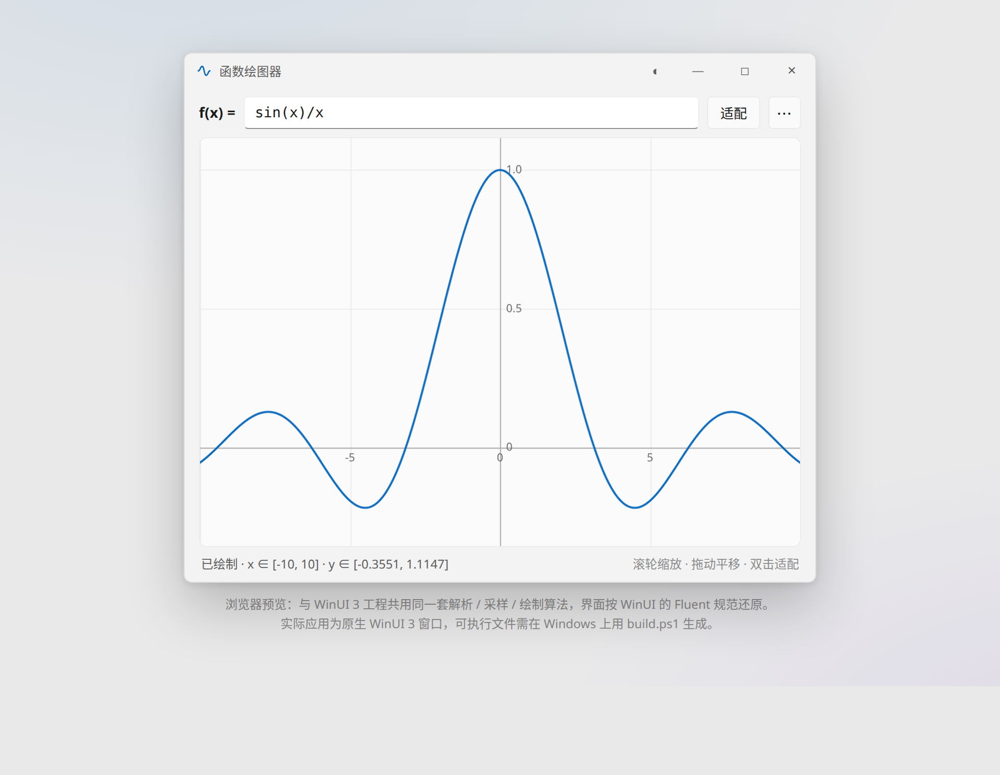
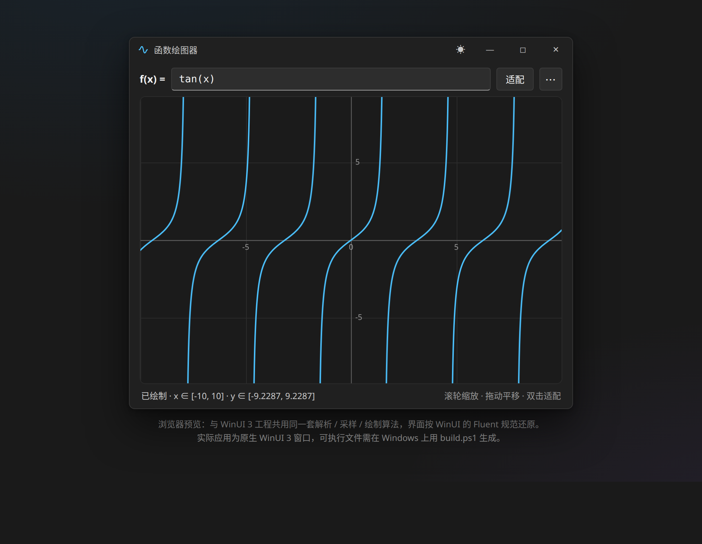

# FunctionPlotter · 函数绘图器

<p align="center">
  
  
</p>

**输入一个关于 `x` 的表达式，小窗口里立刻画出曲线。**

原生 Windows 桌面应用，同一套核心算法提供 **WinUI 3** 与 **UWP** 两个版本，另附零依赖的浏览器预览页。
纯 XAML 矢量绘制，**不依赖 Win2D**；深色 / 浅色主题自动跟随系统。

[](LICENSE)


---

## ✨ 特性

- **实时重绘**：每次按键都重新「解析 → 采样 → 绘制」，小窗口一帧仅 1~2 千次求值，毫秒级完成，不做防抖也不掉帧
- **表达式覆盖面广**：四则运算、隐式乘法（`2x`、`(x+1)(x-1)`）、三角 / 双曲 / 指数对数、绝对值 `|x|`、常量 `pi` `e` `tau` `phi`，输入容错（全角括号、`×` `÷` 自动纠正，`f(x) =` 前缀自动忽略）
- **健壮的曲线处理**：`tan(x)`、`1/x` 在渐近线处正确断开，不多画竖线；自适应 Y 轴用分位数而非 min/max，单个尖峰不会把曲线压扁
- **所见即所得的交互**：滚轮以光标为中心缩放、拖动平移、双击适配、十字光标实时读数
- **AI 自然语言绘图（UWP 版）**：输入「绘制 y=sin(x) 在 -2π 到 2π 的图像」这样的人话，AI 自动转成表达式并画好；内置 **DeepSeek**、**Kimi（月之暗面）**、**小米 MiMo**、**智谱 GLM** 四家国产大模型预设，全部走 OpenAI 兼容接口，下拉即切换，也可填自定义端点（如本地 Ollama）；API Key 存进 Windows 密码保险柜，不落明文
- **打印支持（UWP 版）**：调起系统打印对话框，打印页与屏幕共用同一套绘制管线（同表达式、同视口、同配色），所见即所得
- **一套算法，三个壳**：核心在 `FunctionPlotter.Core`（纯 .NET 类库，零 UI 依赖），WinUI 3 / UWP / 浏览器三个前端共用

## 🚀 快速开始

### 0. 浏览器预览（什么都不用装）

直接打开 [`preview/index.html`](preview/index.html)，界面与交互和桌面版等价（同一套算法的 JS 实现）。

### 1. WinUI 3 桌面版（推荐）

前置：Windows 10 1809+，[.NET 8 SDK](https://dotnet.microsoft.com/download)（用 Visual Studio 的话勾选「.NET 桌面开发」）。

```powershell
git clone https://github.com/yinheqiubangxia/FunctionPlotter.git
cd FunctionPlotter
.\build.ps1              # Release / x64，构建完打印 exe 路径
.\build.ps1 -Run         # 构建并直接启动
```

产物在 `publish\x64\FunctionPlotter.exe`。工程已配置自包含（`WindowsAppSDKSelfContained` + `SelfContained`），
**目标机不需要装 .NET 运行时，也不需要 Windows App Runtime**——把 `publish\x64` 整个目录拷走，双击即用。

### 2. UWP 版

前置：Visual Studio 安装「通用 Windows 平台开发」工作负载 + Windows 10 SDK。

- 打开 `FunctionPlotter.sln`，右键 `FunctionPlotter.UWP` → 设为启动项目 → **F5**；
- 或在项目目录运行 `.\build-uwp.ps1`（脚本自动定位 VS 的构建引擎），随后按提示注册：
  `Add-AppxPackage -Register <AppxManifest.xml 路径>`（需开启开发者模式）。

### 3. 跑测试（63 项核心自检）

```bash
dotnet run --project tests     # 输出 "通过 63 项，失败 0 项"
```

覆盖表达式解析（运算优先级 / 隐式乘法 / 错误定位）、采样与渐近线断点、自适应 Y 轴、坐标换算、刻度生成等。

## 🤖 AI 自然语言绘图（UWP 版）

在函数输入框下方的 AI 栏里直接用自然语言描述，回车或点「AI 绘制」即可：

- 「绘制 y=sin(x) 在 -2π 到 2π 的图像」
- 「画一个开口向上的抛物线，顶点在 (0, -4)」
- 「高斯函数 exp(-x^2)，x 从 -3 到 3」

工作方式：自然语言 → 大模型输出严格 JSON（表达式 + 可选 X 范围）→ 用内置 `ExpressionCompiler` 做合法性校验（模型瞎编语法会被拦下）→ 填回输入框触发实时重绘。

**内置模型预设**（均为 OpenAI 兼容接口，点 ⚙ 填对应 API Key，可在设置里改模型名）：

| 厂商 | 接口地址 | 默认模型 |
|---|---|---|
| DeepSeek（深度求索） | `https://api.deepseek.com` | `deepseek-chat` |
| Kimi（月之暗面 Moonshot） | `https://api.moonshot.cn` | `moonshot-v1-8k` |
| 小米 MiMo | `https://api.xiaomimimo.com` | `mimo-v2-flash` |
| 智谱 GLM（Zhipu AI） | `https://open.bigmodel.cn/api/paas/v4` | `glm-4-flash` |
| 自定义 | 任意 OpenAI 兼容端点（如 `http://localhost:11434/v1`） | 自填 |

> API Key 按厂商分别保存在 Windows 密码保险柜（PasswordVault）中；新增厂商只需在 `FunctionPlotter.Core/Ai/LLMProvider.cs` 里加一条预设。

## 🖨️ 打印（UWP 版）

「更多」菜单 →「打印图像…」调起系统打印对话框（默认横向）。打印页 = 页眉（`f(x) = 表达式`）+ 与屏幕一致的图像区：
打印内容直接克隆屏幕上的 `PlotView`（同表达式、同视口、同一套采样与绘制代码），不经过位图截图，矢量输出清晰不糊。

## ⌨️ 交互一览

| 操作 | 效果 |
|---|---|
| 输入框逐字符输入 | 实时重绘 |
| 鼠标滚轮 | 以光标为中心缩放 |
| 按住左键拖动 | 平移 |
| 双击画布 / `Ctrl+F` / 「适配」按钮 | 按当前 X 范围自动适配 Y 轴 |
| `Ctrl + 加号` / `Ctrl + 减号` | 缩放 |
| `Ctrl+R` | 重置到 x ∈ [-10, 10] |
| 移动鼠标 | 十字光标 + 读数（x 与 f(x)） |

## 📐 表达式语法

| 类别 | 支持内容 |
|---|---|
| 运算 | `+` `-` `*` `/` `^`（右结合，`-2^2 = -4`）、括号、`\|x\|` 绝对值 |
| 隐式乘法 | `2x`、`3(x+1)`、`(x+1)(x-1)`、`2sin(x)`、`x sin(1/x)` |
| 三角 | `sin` `cos` `tan` `cot` `sec` `csc` `asin` `acos` `atan`，`atan2(y,x)` |
| 双曲 | `sinh` `cosh` `tanh` `asinh` `acosh` `atanh` |
| 指数对数 | `exp` `ln` `log`（默认以 10 为底）、`log(x,b)` 指定底、`log2` `log10`、`pow(x,y)` |
| 其它 | `sqrt` `cbrt` `abs` `sign` `floor` `ceil` `round` `trunc` `frac` `hypot` `max` `min` `mod` |
| 角度 | `rad(deg)` / `deg(rad)` 换算 |
| 常量 | `pi` `π` `e` `tau` `phi` |
| 容错 | 自动忽略 `y =` / `f(x) =` 前缀；全角括号、`×` `÷` `−` 自动纠正 |

输错时给出可读提示并定位，例如 `sin(` → “表达式不完整”，`sinn(x)` → “未知的函数…（是不是 sin？）”。

## 📁 目录结构

```
FunctionPlotter/
├─ FunctionPlotter.sln
├─ build.ps1                        一键构建 WinUI 3 版（Windows）
├─ build-uwp.ps1                    一键构建 UWP 版（Windows）
├─ Directory.Build.props            dotnet CLI 构建时的 VS 打包任务定位
├─ docs/                            截图
├─ preview/
│  └─ index.html                    浏览器预览版（同一套算法）
├─ src/
│  ├─ FunctionPlotter.Core/         纯 .NET 类库（表达式解析 / 采样 / 坐标换算）
│  │   └─ Ai/                       AI 层：LLMProvider 预设、AiPlotService（OpenAI 兼容调用）、MiniJson
│  ├─ FunctionPlotter.WinUI/        WinUI 3 应用（Windows App SDK）
│  └─ FunctionPlotter.UWP/          UWP 应用（Windows.UI.Xaml，含 AI 绘图与打印）
└─ tests/                           63 项核心自检（跨平台）
```

## 🧰 构建要求

| 目标 | 要求 |
|---|---|
| WinUI 3 | Windows 10 1809+，.NET 8 SDK（或 VS 2022 17.8+ 勾选「.NET 桌面开发」） |
| UWP | Visual Studio + 「通用 Windows 平台开发」工作负载 + Windows 10/11 SDK |
| 测试 / Core | 任意平台，`dotnet run --project tests` |

> 说明：WinUI 3 的 PRI 打包任务只随 Visual Studio 分发，因此命令行构建需要本机装有 VS
> （`build.ps1` 会自动定位）；仅用 VS IDE 打开构建则无此要求。

## 🤝 贡献

Issue / PR 都欢迎。改核心算法请先跑 `dotnet run --project tests`，保证 63 项自检全绿。

## 📄 许可证

[MIT](LICENSE) © 2026 yinheqiubangxia
